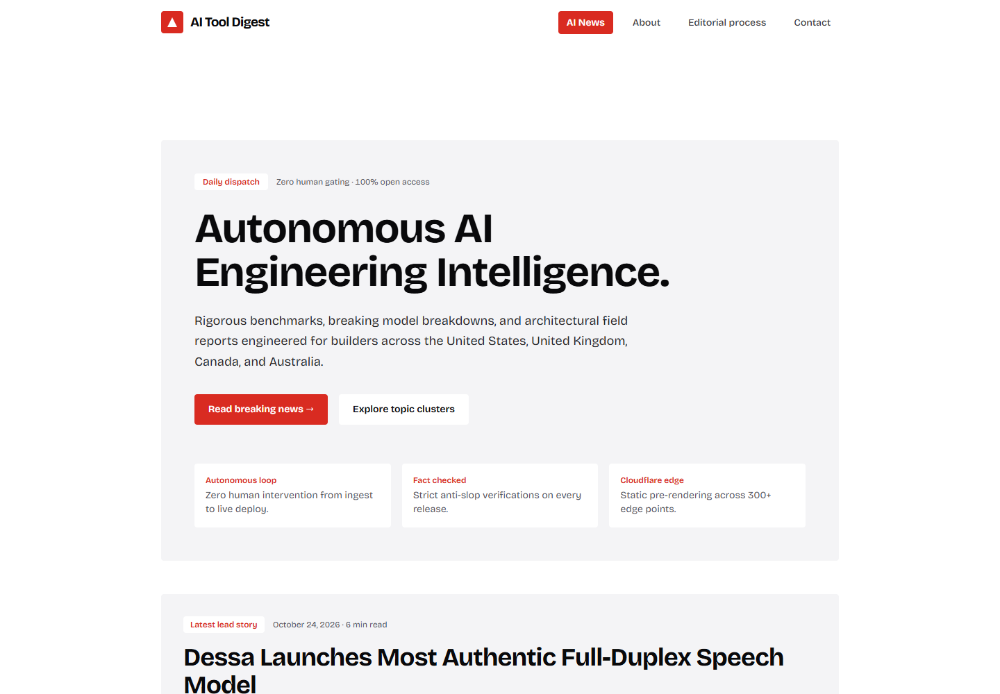
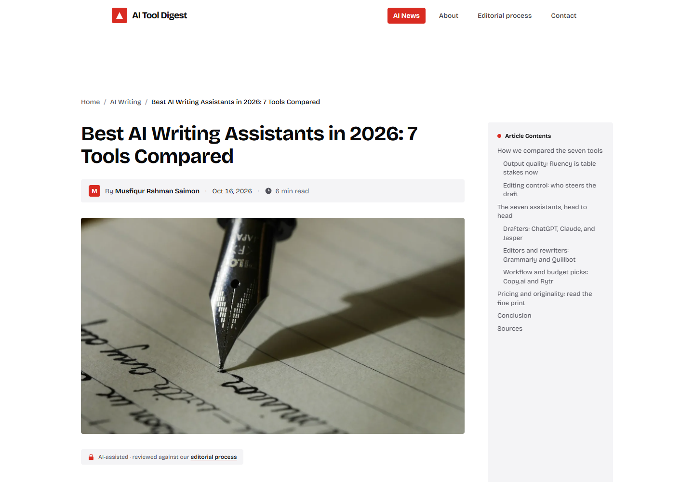
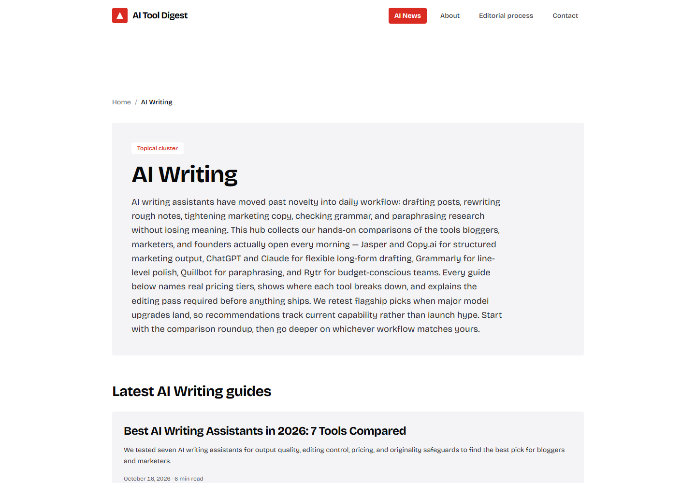
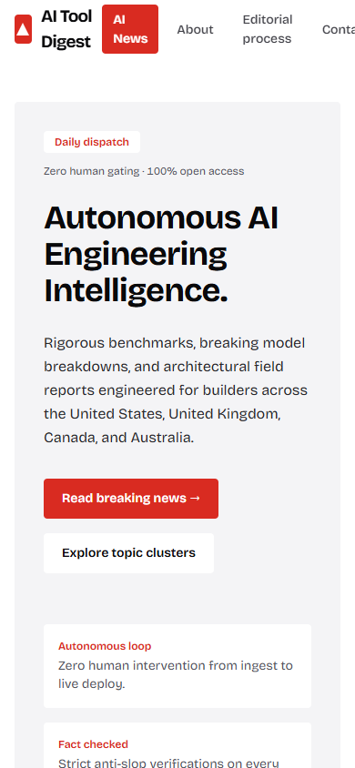
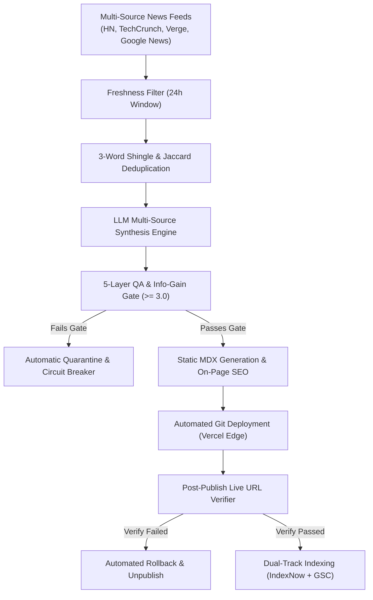

<div align="center">

# 🚀 TierOne AutoBlog

**An autonomous programmatic SEO engine & AI publishing pipeline built for Tier-1 organic search traffic.**

[](https://exclusivesources.online)
[](https://github.com/britsync07-prog/tierone-autoblog/stargazers)
[](LICENSE)
[](tests/)
[](https://nextjs.org/)
[](https://www.typescriptlang.org/)
[](https://tailwindcss.com/)

<p align="center">
  <a href="#-live-site">Live Site</a> •
  <a href="#-visual-showcase">Screenshots</a> •
  <a href="#-behind-the-build-the-solo-developer-journey">The Solo Dev Story</a> •
  <a href="#-how-it-works">Architecture</a> •
  <a href="#-quality-gates--eval-suite">QA Gates</a> •
  <a href="#-quick-start">Quick Start</a> •
  <a href="#-author">Author</a>
</p>

</div>

---

## 🌐 Live Site

Check out the production publication powered by this autonomous engine:
👉 **[https://exclusivesources.online](https://exclusivesources.online)**

---

## 📸 Visual Showcase

| Production Homepage & Silo Navigation | Full-Length Synthesized Article View |
| :---: | :---: |
|  |  |

| Topic Silo & Topical Cluster Hub | Mobile Responsive Experience |
| :---: | :---: |
|  |  |

---

## 👨‍💻 Behind the Build: The Solo Developer Journey

> *"Most autonomous content projects fail because they flood the internet with generic, hallucinated AI fluff that gets crushed by Google's helpful content updates. As an individual independent software engineer, I wanted to build an autonomous pipeline that acts like an elite editorial newsroom: rigorous deduplication, multi-source synthesis, strict Information Gain gates, automated rollback, and instant dual-track search indexing."*  
> — **Musfiqur Rahman Saimon** ([@britsync07-prog](https://github.com/britsync07-prog))

I am **Musfiqur Rahman Saimon**, a solo engineer building open-source production software independently (not a corporation, agency, or VC-backed startup). Architecting and shipping **TierOne AutoBlog** solo meant inventing automated solutions for problems that usually require whole editorial and DevOps teams.

Here are the real problems I encountered while engineering this system and how I solved them:

### 1. Eliminating Generic AI Fluff & Google Spam Penalty Risks
- **The Problem:** Raw LLM generation produces repetitive phrasing, banned buzzwords (*"in this fast-paced digital era"*, *"delve into"*), and shallow summaries that offer zero original value, putting the domain at high risk of algorithmic search penalties.
- **How I Tackled It:** I built an automated multi-stage **Quality Assurance Gate Pipeline** ([`lib/pipeline/qa/`](lib/pipeline/qa/)):
  1. **Information Gain Evaluator:** Scores draft articles on unique data points, comparison matrices, and specific technical citations. If the score falls below `3.0 / 5.0`, the post fails the gate.
  2. **3-Word Shingle Plagiarism & Deduplication:** Generates contiguous tri-grams and calculates Jaccard similarity across past publications to guarantee originality.
  3. **Banned Pattern Filter & Redteam Auditor:** Regex scans for boilerplate filler, hallucinated code tokens, and unfinished placeholder markers (`[TODO]`, `NaN`, `undefined`). Any violation quarantines the draft immediately into `quarantine/`.

### 2. Multi-Source News Ingestion with Near-Duplicate Clustering
- **The Problem:** Ingesting feeds from Hacker News, TechCrunch, The Verge, and Google News often yields 10 different articles covering the exact same breaking story, causing content cannibalization.
- **How I Tackled It:** I developed a deterministic deduplication algorithm ([`lib/pipeline/news/dedup.ts`](lib/pipeline/news/dedup.ts)) that normalizes canonical URLs, extracts primary named entities, and groups related breaking items into a single synthesis cluster. The AI engine synthesizes perspectives from all sources rather than summarizing just one.

### 3. Operating on Zero Budget Without Costly Third-Party APIs
- **The Problem:** Enterprise SEO tools (Ahrefs, Semrush, DataForSEO) charge hundreds of dollars per month for keyword and SERP intelligence—unfeasible for an independent developer.
- **How I Tackled It:** I engineered an internal programmatic keyword clustering model and combined keyless RSS discovery with structured local JSON shard registries ([`lib/pipeline/registry.ts`](lib/pipeline/registry.ts)). This gives TierOne complete autonomy at virtually zero operational cost.

### 4. Post-Publish Verification & Automated Rollback
- **The Problem:** If a scheduled cron job publishes a broken MDX page, missing image, or malformed JSON-LD schema, search crawlers index errors before human intervention is possible.
- **How I Tackled It:** I built a live verifier and circuit breaker ([`lib/pipeline/publish/verifier.ts`](lib/pipeline/publish/verifier.ts)). Immediately upon publication, a background worker polls the live production URL, extracts and parses the HTML, verifies the `Article` and `BreadcrumbList` JSON-LD schema, tests internal links, and ensures zero layout bugs. If verification fails, it executes an **Automated Rollback** ([`lib/pipeline/publish/rollback.ts`](lib/pipeline/publish/rollback.ts)), quarantining the post and resetting git state without manual intervention.

### 5. Dual-Track Instant Indexation
- **The Problem:** Waiting weeks for Googlebot to organically crawl new posts wastes the freshness window of tech news.
- **How I Tackled It:** I created a dual-track indexing coordinator ([`lib/pipeline/indexing/`](lib/pipeline/indexing/)):
  - **IndexNow Protocol:** Instantly pushes new URLs to Bing and Yandex within seconds of publication.
  - **Google Search Console API:** Automatically submits pinged XML sitemaps directly into Google's crawl queue with sanitized private key authentication.

---

## 🏗️ How It Works (Architecture Flow)



---

## 🛡️ Quality Gates & Eval Suite

TierOne includes a complete offline testing suite featuring **159 automated tests**:

```bash
npm test
```

### Highlights from the Test Suite:
- **`eval-20.test.ts`:** Evaluates 20 queries across 5 topical silos to ensure baseline Information Gain `>= 3.0` and 100% structural compliance.
- **`news-dedup.test.ts`:** Verifies Jaccard set similarity and shingle clustering to prevent redundant news publication.
- **`verify-live-url.test.ts`:** Validates live schema parsing, placeholder detection, broken internal link detection, and automated rollback execution.
- **`velocity-governor.test.ts`:** Enforces domain age rules, active corpus limits, and indexation ratio locks to prevent over-publishing penalties.

---

## 🚀 Quick Start

### Prerequisites
- Node.js version 22 or higher
- npm or pnpm

### 1. Clone & Install
```bash
git clone https://github.com/britsync07-prog/tierone-autoblog.git
cd tierone-autoblog
npm install
```

### 2. Environment Configuration
Copy `.env.example` to `.env` and fill in your credentials:
```bash
cp .env.example .env
```

Key environment variables:
- `INDEXNOW_KEY` (optional for Bing instant indexation)
- `GSC_CLIENT_EMAIL` & `GSC_PRIVATE_KEY` (optional for Google Search Console API)
- `ANTHROPIC_API_KEY` or `GEMINI_API_KEY` (for article synthesis)

### 3. Run Test Suite
```bash
npm test
```
All 159 tests run offline with mock fixtures in seconds!

### 4. Run Development Server
```bash
npm run dev
```
Visit `http://localhost:3000` to preview the blog locally.

---

## 🤝 Contributing

Contributions are welcome! Please check out [CONTRIBUTING.md](CONTRIBUTING.md) and review our [Code of Conduct](CODE_OF_CONDUCT.md).

---

## 👤 Author

**Musfiqur Rahman Saimon**
- 🐙 GitHub: [@britsync07-prog](https://github.com/britsync07-prog)
- 💼 Independent Full-Stack Engineer & AI Systems Developer

⭐ **If you find this autonomous SEO architecture innovative or useful, please star the repository!** ⭐

---

## 📄 License

This project is licensed under the [MIT License](LICENSE) - Copyright (c) 2026 Musfiqur Rahman Saimon.
